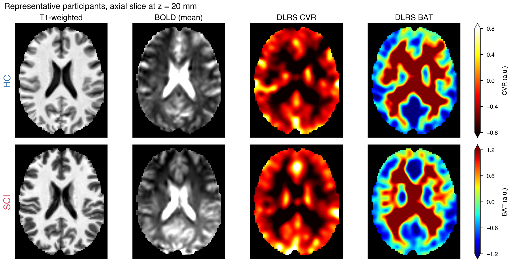
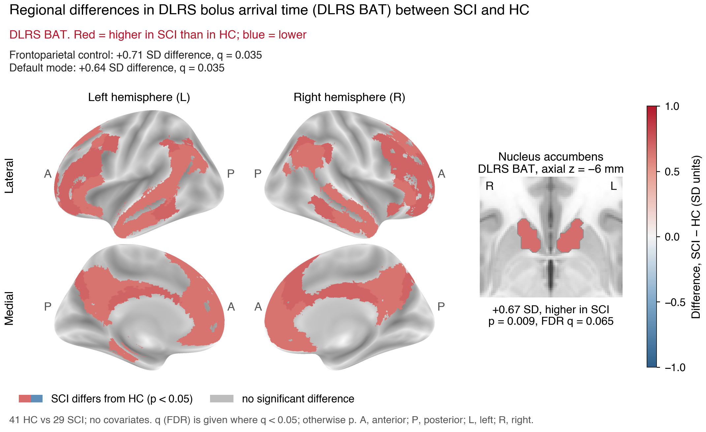
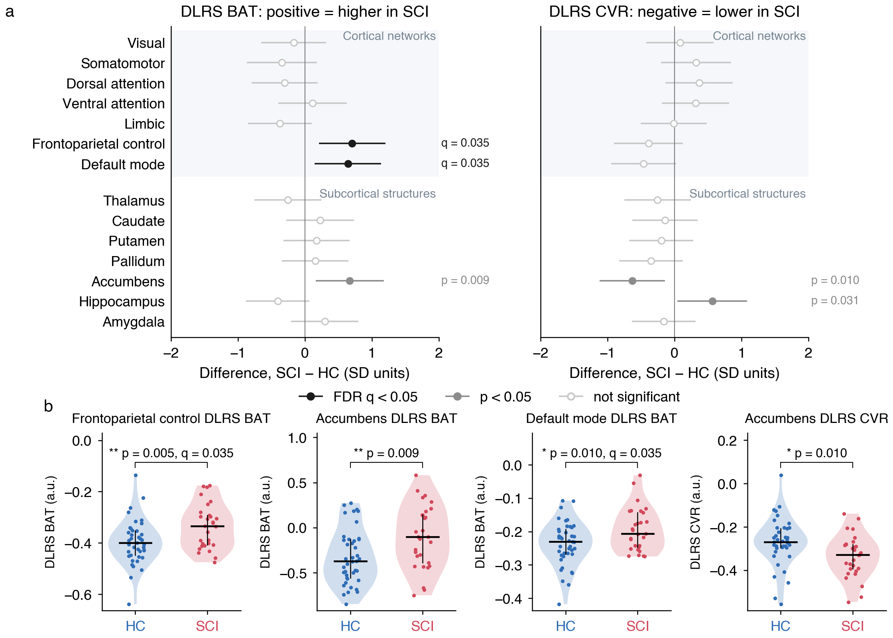

# DLRS CVR and BAT in spinal cord injury


Cerebrovascular reactivity (CVR) and bolus arrival time (BAT) maps from
resting-state fMRI, without a gas challenge, using the pretrained deep-learning
resting-state (DLRS) model of Hou et al. (2023). This repository holds the
fMRIPrep preprocessing, the MATLAB feature step, model inference, and the group
comparison of spinal cord injury (SCI) and healthy control (HC) participants.

## Pipeline

```
raw scans (PAR/REC, DICOM)
  fmriprep/01-02      BIDS conversion (dcm2niix v1.0.20230411)
  fmriprep/03         fMRIPrep 25.2.6, MNI152NLin6Asym 2 mm
  fmriprep/04-06      QC, run selection, censoring, MATLAB input
  preprocessing/      MATLAB: 136 input channels (133 ROI correlation maps + 3 GLM priors)
  src/                pretrained U-Net, separate CVR and BAT decoders
  src/analysis/       regional means, group comparison, repeatability, figures
```

Model outputs are in arbitrary units. Display ranges: CVR [-0.8, 0.8], BAT [-1.2, 1.2].

## Preprocessing

| Step | Setting |
|---|---|
| Slice timing | sequential ascending, `--slice-time-ref 0` |
| Space | `MNI152NLin6Asym:res-2` (91 x 109 x 91, the atlas grid) |
| Detrending | linear, per run, before the runs are joined |
| Smoothing | 8 mm (MATLAB step) |
| Filtering | 0-0.1164 Hz (MATLAB step) |
| Motion covariates | 6 fMRIPrep parameters and their squares, filtered like the BOLD signal |
| Censoring | frame-to-frame motion > 0.4 mm (and the volume before), or > 10% outlier voxels (AFNI `3dToutcount`) |
| Exclusion | > 25% of volumes censored, or missing age, sex or time since injury (`src/analysis/cohort_exclusions.py`) |

Censored volumes are left out of the delay search and of every regression that
builds the input maps; filtering is done on the full series first.

## Layout

```
fmriprep/          BIDS conversion, fMRIPrep, QC, MATLAB input
preprocessing/     MATLAB feature generation (SPM12 installed separately)
  rs_running_fmriprep.m   fMRIPrep input (used for the results below)
  rs_running.m            raw BOLD through the original SPM preprocessing
  utils/                  per-step routines
  atlas/                  one empty folder per atlas (files not tracked; see Atlases)
src/               model, training, inference
  analysis/        group statistics and figures
figure/            main figures only
model/             pretrained weights (not tracked)
```

## Setup

```bash
conda create -n cvr_bat python=3.9
conda activate cvr_bat
pip install -r requirements.txt
```

- Docker with `nipreps/fmriprep:25.2.6` and a FreeSurfer license (`FS_LICENSE`)
- dcm2niix v1.0.20230411 and AFNI (`3dToutcount`) on the path
- MATLAB with SPM12 in `preprocessing/spm12/`
- pretrained weights in `model/pretrained_DLRS_CVR_BAT_model.pt`

## Atlases

Atlas files are not tracked. Put them in the matching empty folder in
`preprocessing/atlas/`:

| Folder | Files | Source |
|---|---|---|
| `labels_Neuromorphometrics/` | `wlabels_Neuromorphometrics_unique.nii` | SPM12 Neuromorphometrics labels on the 91 x 109 x 91 grid, from the DLRS code of Hou et al. (2023) |
| `schaefer_2018/` | `Schaefer2018_200Parcels_7Networks_order_FSLMNI152_1mm.nii.gz`, `Schaefer2018_200Parcels_7Networks_order.txt` | [CBIG, Schaefer 2018](https://github.com/ThomasYeoLab/CBIG/tree/master/stable_projects/brain_parcellation/Schaefer2018_LocalGlobal/Parcellations/MNI) |
| `tian_s1/` | `Tian_Subcortex_S1_3T_2009cAsym.nii.gz`, `Tian_Subcortex_S1_3T_label.txt` | [Tian subcortex atlas, 3T, scale 1](https://github.com/yetianmed/subcortex/tree/master/Group-Parcellation/3T/Subcortex-Only) |

## Configuration

Input and output folders are set at the top of each `fmriprep/` script.
Per-participant exceptions for BIDS conversion go in `fmriprep/local_config.json`
(see `local_config.example.json`).

## Running

```bash
# 1. BIDS and fMRIPrep
python fmriprep/01_survey_scans.py
python fmriprep/02_convert_to_bids.py --subjects <intake_folder> ...
bash fmriprep/03_run_fmriprep.sh sci01 hc01
python fmriprep/04_qc_outputs.py
python fmriprep/06_prepare_dlrs_input.py

# 2. MATLAB features
matlab -batch "cd preprocessing; rs_running_fmriprep"

# 3. Inference
DLRS_DATA_DIR=<data> python src/DLRS_CVR_BAT_inference.py

# 4. Analysis
export DLRS_DATA_DIR=<data>
python src/analysis/regional_means.py
python src/analysis/group_comparison.py
python src/analysis/dlrs_glm_agreement.py
DLRS_RETEST_DIR=<data_retest>/output/HC_subj python src/analysis/reliability.py
python src/analysis/make_figures.py
```

`fmriprep/07_after_fmriprep.sh` runs QC, the MATLAB input and the MATLAB step
once all fMRIPrep containers have finished.

`group_comparison.py` reads `participants.tsv` (columns `subject`, `age`, `sex`),
which is not tracked. Tables are written to `results/` (not tracked).

## Analysis

| Script | Output |
|---|---|
| `regional_means.py` | mean CVR and BAT per participant: whole brain, 7 cortical networks (Yeo-7), 7 subcortical structures (Tian S1) |
| `group_comparison.py` | SCI - HC differences in pooled-SD units for four models: no covariates (Welch), age, motion, age + motion; Benjamini-Hochberg FDR within each family of seven regions |
| `reliability.py` | run-to-run ICC(2,1) in 216 parcels (Schaefer 200 + Tian S1), healthy controls with two separately processed runs |
| `dlrs_glm_agreement.py` | spatial correlation of DLRS and GLM maps per participant |
| `make_figures.py` | figures below (Figure 1 also needs the fMRIPrep and MATLAB input folders) |

## Figures

41 HC and 29 SCI participants, no covariates.

**Figure 1.** Representative participants: T1-weighted, mean BOLD, DLRS CVR and DLRS BAT.



**Figure 2.** Cortical networks and nucleus accumbens with a DLRS BAT difference between SCI and HC.



**Figure 3.** SCI - HC differences in all 14 regions (a) and participant values for the four regions with the smallest p (b).



## Reference

Hou X, Guo P, Wang P, Liu P, Lin DDM, Fan H, et al. Deep-learning-enabled brain
hemodynamic mapping using resting-state fMRI. NPJ Digit Med. 2023;6(1):116.
doi:10.1038/s41746-023-00859-y
